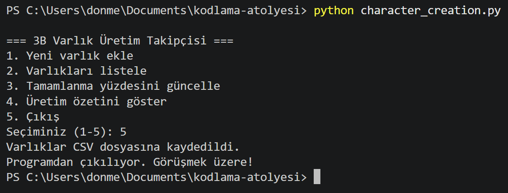
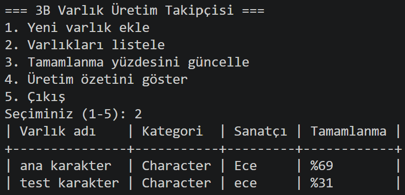
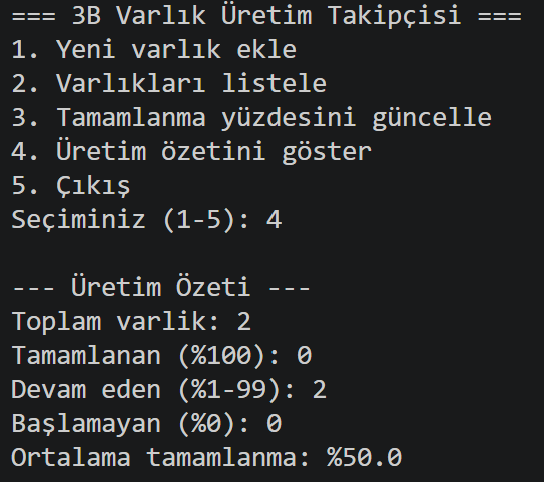

# 3B Varlık Üretim Takipçisi

## Projenin amacı

Bu komut satırı uygulaması, küçük bir oyun geliştirme ekibinin 3B varlıklarının üretim durumunu takip etmesine yardımcı olur. Her varlık için ad, kategori, atanan sanatçı ve tamamlanma yüzdesi tutulur.

## Özellikler

- Karakter, çevre veya obje kategorisinde varlık ekleme
- Varlıkları düzenli bir tabloda listeleme
- Varlıkların tamamlanma yüzdesini güncelleme
- Toplam, tamamlanan, devam eden ve başlamayan varlıkları özetleme
- Ortalama tamamlanma yüzdesini hesaplama
- Varlıkları `assets.csv` dosyasına kaydetme ve program açılırken yükleme
- Boş alan, hatalı kategori, sayı olmayan yüzde ve aralık dışı değerler için doğrulama
- Geçersiz menü seçimleri, bulunamayan varlıklar ve bozuk/eksik CSV dosyaları için anlaşılır uyarı

Uygulama yalnızca Python'un standart kütüphanesini kullanır; ek paket gerekmez. Kategori girerken `Character`, `Environment`, `Prop` ya da `Karakter`, `Çevre`, `Obje` yazılabilir.

## Kurulum ve çalıştırma

1. [Python 3'ü resmi indirme sayfasından indirin](https://www.python.org/downloads/) ve kurulum dosyasını çalıştırın.
2. Windows'taki kurulum ekranında **Add Python to PATH** kutusunu işaretleyin. Bu seçenek, terminalin Python komutunu bulmasını sağlar. Ardından kurulumu tamamlayın.
3. Kurulumun doğrulandığını kontrol etmek için yeni bir terminal açıp `python --version` komutunu çalıştırın. Python sürüm numarası görünmelidir. Bu komut çalışmazsa `py --version` komutunu deneyin.
4. VS Code'da bu proje klasörünü açın.
5. Terminali **Terminal > New Terminal** menüsüyle açın.
6. Aşağıdaki komutu çalıştırın:

   ```text
   python character_creation.py
   ```

   Windows'ta `python` komutu çalışmazsa şu komutu deneyin:

   ```text
   py character_creation.py
   ```

Program kayıt dosyasını betiğin bulunduğu proje klasöründeki `assets.csv` dosyasında tutar. Dosya ilk çalıştırmada henüz yoksa program boş listeyle başlar; ilk kayıt eklendiğinde dosya oluşturulur.

## Örnek kullanım

```text
=== 3B Varlık Üretim Takipçisi ===
1. Yeni varlık ekle
2. Varlıkları listele
3. Tamamlanma yüzdesini güncelle
4. Üretim özetini göster
5. Çıkış
Seçiminiz (1-5): 1
Varlık adı: Orman Koruması
Kategori (Character/Karakter, Environment/Çevre, Prop/Obje): Character
Atanan sanatçı: Deniz
Tamamlanma yüzdesi (0-100): 35
'Orman Koruması' varlığı listeye eklendi.
Varlıklar CSV dosyasına kaydedildi.
```

Yüzde yerine harf girilirse veya 0-100 aralığı dışında bir sayı yazılırsa uygulama uyarı verir ve yeniden giriş ister.

## Ekran görüntüleri

Çalıştırma, varlık listesi ve üretim özeti ekran görüntülerinizi bu bölüme ekleyin:

- **Ekran görüntüsü 1 – Ana menü:** 
- **Ekran görüntüsü 2 – Varlık listesi:** 
- **Ekran görüntüsü 3 – Üretim özeti veya girdi doğrulaması:** 
